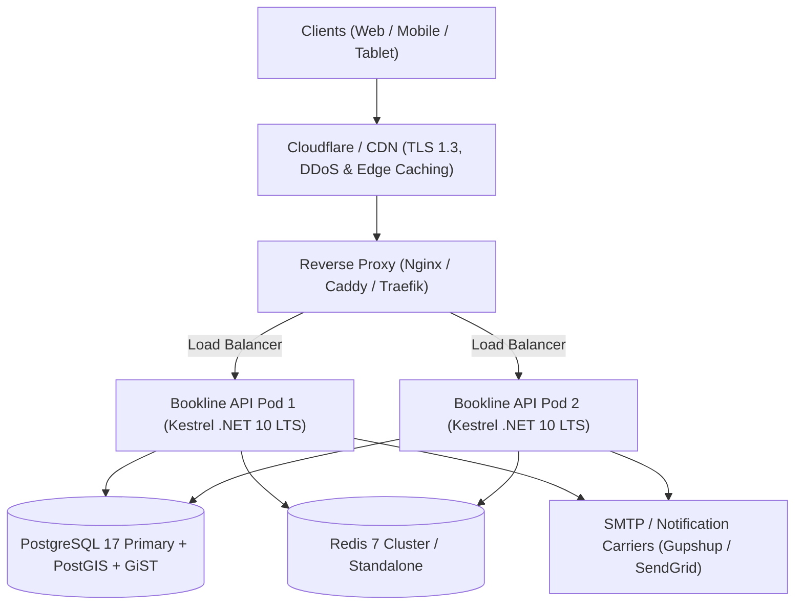

# Bookline — Production Deployment Guide

This guide details the deployment topology, container build pipelines, reverse proxy configurations, and release procedures for the Bookline platform.

---

## 1. System Architecture & Topology



---

## 2. Container Build & Packaging

Bookline is packaged as a unified multi-stage container that compiles the React TypeScript frontend SPA and serves it directly via ASP.NET Core `UseStaticFiles()` and `UseSpaFallback()`, eliminating cross-origin CORS overhead in production.

### Multi-Stage Dockerfile Architecture

```dockerfile
# Stage 1: Build React Frontend
FROM node:20-alpine AS frontend-builder
WORKDIR /app/frontend
COPY frontend/package*.json ./
RUN npm ci
COPY frontend/ ./
RUN npm run build

# Stage 2: Build .NET 10 Backend
FROM mcr.microsoft.com/dotnet/sdk:10.0 AS backend-builder
WORKDIR /app
COPY backend/Directory.Build.props ./
COPY backend/*.sln* ./
COPY backend/src/*/*.csproj ./src/
RUN for file in src/*.csproj; do mkdir -p "src/${file%.csproj}" && mv "$file" "src/${file%.csproj}/"; done
RUN dotnet restore backend/Bookline.slnx

COPY backend/ ./backend
COPY --from=frontend-builder /app/frontend/dist ./backend/src/Bookline.Api/wwwroot
WORKDIR /app/backend/src/Bookline.Api
RUN dotnet publish -c Release -o /out

# Stage 3: Production Runtime (.NET 10 LTS)
FROM mcr.microsoft.com/dotnet/aspnet:10.0 AS runtime
WORKDIR /app
COPY --from=backend-builder /out ./
EXPOSE 5168
ENV ASPNETCORE_ENVIRONMENT=Production
ENV ASPNETCORE_URLS=http://+:5168
ENTRYPOINT ["dotnet", "Bookline.Api.dll"]
```

---

## 3. Reverse Proxy Configuration (Nginx)

Place an Nginx reverse proxy in front of Bookline to handle TLS termination, request throttling, and security headers:

```nginx
server {
    listen 443 ssl http2;
    server_name bookline.in app.bookline.in;

    ssl_certificate /etc/letsencrypt/live/bookline.in/fullchain.pem;
    ssl_certificate_key /etc/letsencrypt/live/bookline.in/privkey.pem;
    ssl_protocols TLSv1.2 TLSv1.3;
    ssl_ciphers HIGH:!aNULL:!MD5;

    # Security headers
    add_header X-Content-Type-Options "nosniff" always;
    add_header X-Frame-Options "DENY" always;
    add_header X-XSS-Protection "1; mode=block" always;
    add_header Referrer-Policy "strict-origin-when-cross-origin" always;
    add_header Strict-Transport-Security "max-age=31536000; includeSubDomains" always;

    client_max_body_size 10M;

    location / {
        proxy_pass http://127.0.0.1:5168;
        proxy_http_version 1.1;
        proxy_set_header Upgrade $http_upgrade;
        proxy_set_header Connection keep-alive;
        proxy_set_header Host $host;
        proxy_cache_bypass $http_upgrade;
        proxy_set_header X-Forwarded-For $proxy_add_x_forwarded_for;
        proxy_set_header X-Forwarded-Proto $scheme;
        proxy_set_header X-Correlation-ID $request_id;
    }

    # Static assets caching
    location ~* \.(?:ico|css|js|gif|jpe?g|png|woff2?|eot|ttf|svg)$ {
        proxy_pass http://127.0.0.1:5168;
        expires 30d;
        add_header Cache-Control "public, no-transform";
    }
}
```

---

## 4. Public Staging Deployment (Phase 7.6)

Bookline includes a dedicated staging deployment topology (`docker-compose.staging.yml`) configured for public verification prior to production rollout:

### Staging Deployment Artifacts:
- **Compose Configuration**: [`docker-compose.staging.yml`](file:///c:/z-projects/Bookline/docker-compose.staging.yml)
- **Environment Template**: [`.env.staging.example`](file:///c:/z-projects/Bookline/.env.staging.example)
- **Nginx Staging Configuration**: [`nginx/staging.conf`](file:///c:/z-projects/Bookline/nginx/staging.conf)

### Staging Deployment Procedure:
```bash
# 1. Create staging environment configuration from template
cp .env.staging.example .env.staging
# Edit .env.staging and set strong staging secrets (POSTGRES_PASSWORD, REDIS_PASSWORD, JWT_SECRET_KEY)

# 2. Launch staging stack
docker compose -f docker-compose.staging.yml --env-file .env.staging up -d --build

# 3. Verify health & readiness
curl -f http://localhost/health
curl -f http://localhost/ready

# 4. View real-time logs
docker compose -f docker-compose.staging.yml logs -f bookline-api
```

---

## 5. Production Release Checklist

Before directing customer traffic to the newly deployed container:

1. **Verify Liveness Probe**:
   ```bash
   curl -i http://localhost:5168/health
   # Expected: HTTP 200 OK
   ```

2. **Verify Readiness Probe**:
   ```bash
   curl -i http://localhost:5168/ready
   # Expected: HTTP 200 OK with PostgreSQL, Redis, and Outbox reported Healthy
   ```

3. **Verify Database Seeding Lock**:
   Inspect backend startup logs:
   ```bash
   docker logs bookline-api | grep "MarketplaceDbSeeder"
   # Verify NO dev seed data executed in Production
   ```

4. **Verify Frontend Asset Delivery**:
   ```bash
   curl -I http://localhost:5168/
   # Expected: HTTP 200 with text/html content type
   ```

5. **Verify API Storefront Endpoint**:
   ```bash
   curl -s http://localhost:5168/api/v1/public/businesses/aura-wellness | grep -o "Aura Wellness"
   # Expected: Match found
   ```

---

## 5. Rollback Playbook

If a critical failure occurs during deployment:
1. Re-tag previous container image: `docker tag bookline-api:previous bookline-api:latest`.
2. Restart container or redeploy Kubernetes deployment:
   ```bash
   kubectl rollout undo deployment/bookline-api
   ```
3. Confirm readiness probe passes on rolled-back pod: `curl -f http://localhost:5168/ready`.

