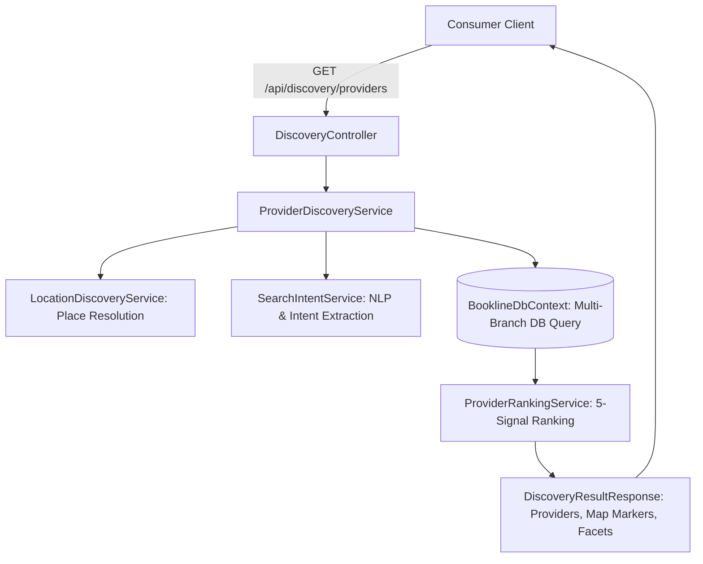

# Consumer Discovery Service Architecture

## 1. Overview
The Bookline Discovery Service coordinates location resolution, spatial bounding, text search, categorization, ranking, and real-time interactive mapping into a unified consumer marketplace interface.



---

## 2. API Endpoints
All discovery endpoints are unauthenticated and public.

| Endpoint | Method | Purpose |
|---|---|---|
| `/api/discovery/providers` | `GET` | Main discovery search with filters, bounding box, sorting, and pagination |
| `/api/discovery/places/search` | `GET` | Autocomplete search for cities, neighborhoods, and postal codes |
| `/api/discovery/places/resolve` | `POST` | Resolves selected place or raw GPS coordinates into search bounds |
| `/api/discovery/categories` | `GET` | Returns commercial category tiles with active provider counts |
| `/api/discovery/cities` | `GET` | Returns top marketplace cities with geographic centers |
| `/api/discovery/nearby` | `GET` | Shortcut query for current coordinate radius searches |

---

## 3. Query Parameters & Semantics
`GET /api/discovery/providers` accepts the following query parameters:

| Parameter | Type | Description |
|---|---|---|
| `q` | `string?` | Free-text keyword matching business name, services, and description |
| `category` | `string?` | Category slug (e.g., `beauty-wellness`, `hair-styling`) |
| `service` | `string?` | Service slug (e.g., `holistic-massage`, `balayage`) |
| `city` | `string?` | City filter (e.g., `Ahmedabad`, `Mumbai`, `Bangalore`) |
| `area` | `string?` | Micro-neighborhood filter (e.g., `Bodakdev`, `Satellite`, `Bandra`) |
| `lat` / `lng` | `double?` | Customer reference coordinates for distance calculations |
| `radius` | `double?` | Radius constraint in kilometers (defaults to 5km when coords provided) |
| `radiusMeters`| `double?` | Explicit radius constraint in meters |
| `swLat`, `swLng`, `neLat`, `neLng` | `double?` | Spatial map viewport bounds |
| `minRating` | `double?` | Quality threshold (e.g., `4.0`, `4.5`, `4.8`) |
| `maxPrice` | `decimal?` | Budget ceiling filter |
| `sort` | `string` | Sort mode: `Recommended`, `Nearest`, `TopRated`, `MostReviewed`, `LowestPrice` |
| `page` / `pageSize` | `int` | Pagination controls (default: `page=1`, `pageSize=12`) |
| `includeMarkers` | `bool` | Returns lightweight marker array for the interactive map |

---

## 4. Multi-Branch Business Expansion
A key invariant of Bookline is that **a business with multiple physical branches appears as distinct physical location results**:
- If `Aura Wellness` operates branches in *Bodakdev* and *Vastrapur*, discovery surfaces two separate cards:
  - `Aura Wellness & Spa (Bodakdev Flagship)` — with Bodakdev distance and address.
  - `Aura Wellness & Spa (Vastrapur Lounge)` — with Vastrapur distance and address.
- Customers book appointments at a specific physical location, ensuring staff and resource availability are strictly accurate.

---

## 5. Server-Side Public Visibility Guards
To protect platform integrity and confidentiality, the discovery query strictly applies server-side filters before processing:
```csharp
tenantsQuery = tenantsQuery.Where(t =>
    t.IsActive &&
    t.IsPublished &&
    t.ModerationStatus == ModerationStatus.Approved);
```
- **Unpublished Providers**: Draft, suspended, or unlisted venues are never indexed.
- **Unapproved Providers**: Venues awaiting administrative review cannot appear in search results.
- **Archived Services / Locations**: Filtered out automatically.

---

## 6. Supported Sort Modes
1. **`Recommended`** (Default): Multi-factor 5-signal deterministic ranking model balancing text relevance, distance, Bayesian smoothed rating, verification, and calendar availability.
2. **`Nearest`**: Ascending order by `DistanceKm`. Requires reference coordinates.
3. **`TopRated`**: Descending order by `RatingAverage`.
4. **`MostReviewed`**: Descending order by `ReviewCount`.
5. **`LowestPrice`**: Ascending order by service starting price.
6. **`HighestPrice`**: Descending order by service starting price.

---

## 7. No-Results & Error Resilience
- When zero providers match a restrictive filter combination, discovery responds with HTTP 200 OK, returning an empty `items` array, zero `totalCount`, and helpful facet statistics, rather than throwing an exception.
- The UI renders an actionable empty state inviting the customer to expand their search radius or clear specific category filters.
