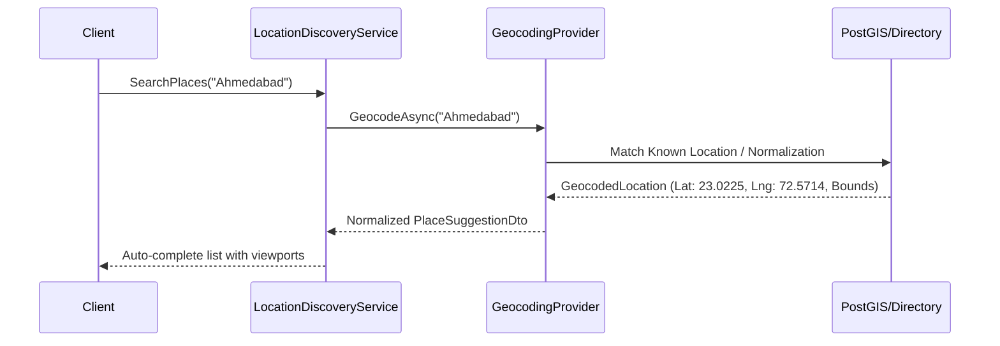

# Geocoding & Address Normalization Architecture

## 1. Overview
The Geocoding subsystem maps free-text client queries, postal codes, and city names into structured geographical coordinates, and performs reverse geocoding to resolve raw GPS points into canonical metropolitan identities.



---

## 2. Selected Provider & Strategy
Bookline employs a hybrid geocoding strategy:
1. **Primary Development & Air-Gapped Engine**: Deterministic In-Memory Directory (`GeocodingProvider`) covering core Indian and international metropolitan hubs (Ahmedabad, Mumbai, Bangalore, Pune, Surat, Rajkot, Delhi, London, New York) with micro-neighborhood boundaries and postal codes.
2. **Production External Engine**: Configurable adapters for Nominatim (OpenStreetMap), Google Places API, or Mapbox Geocoding API via `IGeocodingProvider`.

### Environment Configuration
The system is configured via environment variables:
| Variable | Description | Default |
|---|---|---|
| `BOOKLINE_GEOCODING_PROVIDER` | Provider identifier (`Internal`, `Nominatim`, `Google`, `Mapbox`) | `Internal` |
| `BOOKLINE_GEOCODING_API_KEY` | External service authentication key | `""` (Not required for Internal) |
| `BOOKLINE_GEOCODING_BASE_URL` | Optional custom proxy or self-hosted endpoint | `""` |
| `BOOKLINE_GEOCODING_CACHE_TTL_HOURS` | In-memory / Redis cache duration for geocoded queries | `168` (7 Days) |

---

## 3. Response Normalization
All geocoding responses are normalized into standard immutable data structures:
```csharp
public record GeocodedLocation(
    string FormattedAddress,
    string City,
    string State,
    string Country,
    string PostalCode,
    double Latitude,
    double Longitude
);
```

### Normalization Pipeline
1. **Query Sanitization**: Strips excessive whitespace, control characters, and normalizes capitalization.
2. **Exact Postal Match**: Queries matching 6-digit Indian PIN codes (e.g., `380054`) directly resolve to neighborhood centers.
3. **Compound Address Splitting**: Identifies neighborhood and parent city pairs (e.g. `Bodakdev, Ahmedabad`).
4. **Fallback Handling**: Unrecognized queries default safely to structured fallback records rather than returning 500 errors or crashing.

---

## 4. Reverse Geocoding
Resolves consumer coordinate pairs `(latitude, longitude)` into the nearest recognizable municipal entity.
- Computes Haversine distance to all regional anchor points.
- If within regional radius ($\le 100\text{ km}$), assigns the nearest city (e.g., `23.0396, 72.5074` $\to$ `Ahmedabad`).
- Distant queries gracefully default to regional hub without throwing exceptions.

---

## 5. Caching & Rate Limiting
- **Cache Key**: `geo:geocode:{normalized_query_hash}`
- **TTL**: 7 days for forward geocoding, 30 days for postal codes.
- **Circuit Breaker**: If external API calls fail or return 429/500 errors, the engine seamlessly switches to internal directory lookup without user interruption.

---

## 6. Known Limitations
- The internal geocoding engine is curated for target commercial zones. Expanding to new regional territories requires adding corresponding polygon bounds and anchor coordinates to `LocationDiscoveryService.Directory`.
