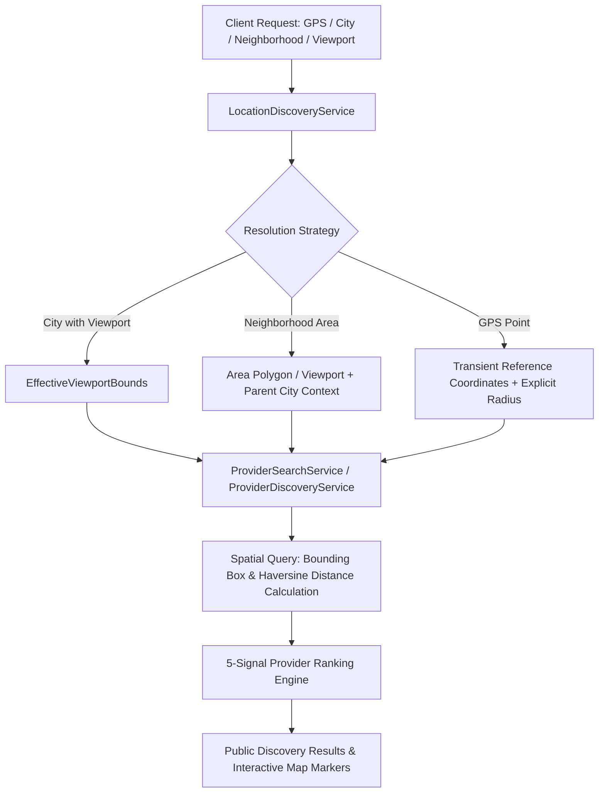

# Geographic Architecture & Spatial Discovery

## 1. Executive Overview
Bookline implements a multi-tier geographic architecture designed to deliver sub-second discovery while preserving consumer privacy and maintaining deterministic spatial bounds. The system rejects the simplistic assumption that every city is adequately represented by a tiny point radius, instead operating on bounding-box viewports, micro-neighborhood directories, and explicit configurable radius models.



---

## 2. Spatial Column Design & Coordinate Conventions
All geographical entities within Bookline standardize on the **WGS 84 (EPSG:4326)** standard coordinate reference system.

### Coordinate Standards
- **Latitude**: Formatted in decimal degrees, strictly bounded within `[-90.0, +90.0]`. North of equator is positive, South is negative.
- **Longitude**: Formatted in decimal degrees, strictly bounded within `[-180.0, +180.0]`. East of prime meridian is positive, West is negative.
- **Precision**: Coordinates stored to 6 decimal places (~0.11 meter resolution at equator) preventing truncation distortions.
- **Storage**:
  - `Latitude`: `double precision` / `DECIMAL(9,6)`
  - `Longitude`: `double precision` / `DECIMAL(9,6)`
  - Spatial Point: PostGIS `geography(Point, 4326)` for native spatial indexing in PostgreSQL.

---

## 3. Spatial Indexes & Query Mechanics
In production PostgreSQL/PostGIS environments, locations are indexed using GiST (Generalized Search Tree) spatial indexes:
```sql
CREATE INDEX idx_locations_spatial ON "Locations" USING GIST (
    ST_SetSRID(ST_MakePoint("Longitude", "Latitude"), 4326)::geography
);
```

### Search Primitives
1. **Bounding-Box (Viewport) Query**:
   ```sql
   WHERE "Latitude" >= :swLat AND "Latitude" <= :neLat
     AND "Longitude" >= :swLng AND "Longitude" <= :neLng
   ```
   For boxes crossing the 180th meridian (Antimeridian):
   ```sql
   WHERE "Latitude" >= :swLat AND "Latitude" <= :neLat
     AND ("Longitude" >= :swLng OR "Longitude" <= :neLng)
   ```
2. **Haversine Distance**:
   Calculated deterministically using Earth mean radius $R = 6371.0 \text{ km}$.
   $$d = 2R \arcsin\left(\sqrt{\sin^2\left(\frac{\Delta\phi}{2}\right) + \cos(\phi_1)\cos(\phi_2)\sin^2\left(\frac{\Delta\lambda}{2}\right)}\right)$$

---

## 4. Radius & Viewport Semantics
- **Selected City**: Prefers geographic bounding box (`ViewportBounds`) representing the full municipal metropolitan extent (e.g., Ahmedabad macro viewport $22.9400 \to 23.1400$ Lat, $72.4600 \to 72.6800$ Lng) rather than an arbitrary small circle.
- **Selected Neighborhood**: Uses micro-viewport (e.g., Bodakdev, Satellite, Bandra West) while retaining the parent city identifier for macro categorization.
- **GPS Coordinates**: Uses configurable explicit search radius (default: 5.0 km, max: 500.0 km). Never assumes infinite reach.
- **Map Movement**: Panning triggers interactive bounds query without triggering infinite request loops.

---

## 5. Consumer Privacy Architecture
- **Transient GPS State**: Current GPS coordinates are classified as transient session data. Exact latitude and longitude are never embedded into shareable customer URLs.
- **Privacy-Safe Slugs**: Shareable discovery URLs use non-identifying query slugs such as:
  - `?city=ahmedabad&area=bodakdev`
  - `?viewport=22.9400,72.4600,23.1400,72.6800`
- **Location Storage**: Only authorized staff/tenant locations are stored permanently. Customer precise coordinates are discarded post-query.

---

## 6. Failure Modes & Graceful Degradation
1. **Geolocation Denied**: If a customer denies browser GPS permissions, discovery operates seamlessly in City mode without error banners. Distance columns are set to `null` and sorting defaults to `Recommended` or `TopRated`.
2. **Out of Bounds Coordinates**: Coordinates exceeding valid world limits are safely rejected with `GeoValidationAndFormatting.IsValidCoordinates` returning `false`.
3. **Invalid Viewport**: If southwest latitude exceeds northeast latitude, bounding box validation fails gracefully and falls back to city-level search.
