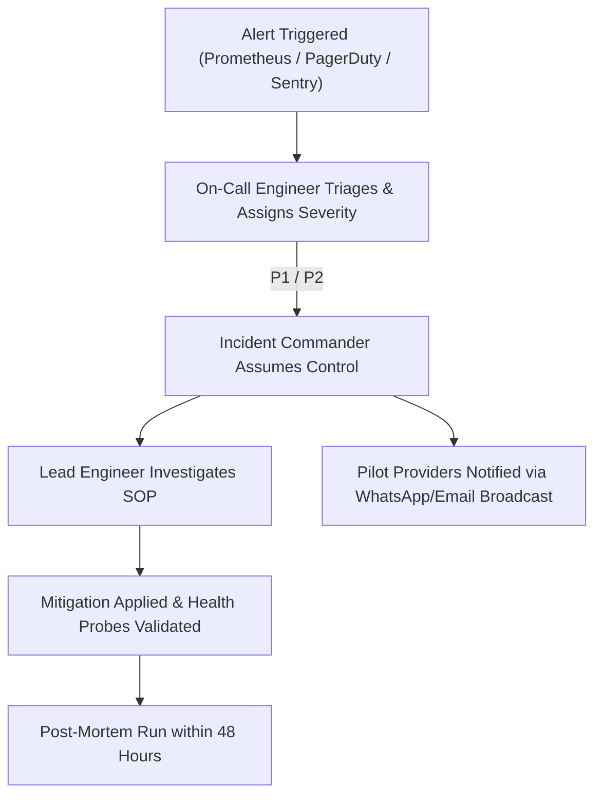

# Bookline — Incident Response & Triage Standard Operating Procedures (SOP)

This document provides structured response protocols for engineers and platform administrators managing production incidents for the Bookline pilot.

---

## 1. Incident Severity Matrix

| Severity | Definition | Target Response (MTTR) | Examples |
|---|---|---|---|
| **P1 - Critical** | Full outage or catastrophic data compromise affecting all tenants or core booking functionality. | **< 15 minutes** | PostgreSQL primary down, API returning 500 across all routes, double bookings occurring. |
| **P2 - Major** | Degraded performance or secondary subsystem failure impacting multiple providers or customers. | **< 45 minutes** | Outbox worker stalled, SMS gateway rejecting messages, Redis unavailable, rate limiter flapping. |
| **P3 - Minor** | Localized issue impacting a single provider or non-critical feature. | **< 4 hours** | Avatar upload failing, single provider working hours glitch, minor UI alignment bug. |
| **P4 - Low** | Low-priority cosmetic or reporting discrepancy. | **Next Release** | Admin analytics dashboard minor formatting error. |

---

## 2. Escalation & Communication Flow



---

## 3. Standard Operating Procedures (SOP)

### SOP-01: PostgreSQL Database Unavailable or Connection Pool Exhausted

**Symptoms**: `/ready` returns HTTP 503; `Npgsql.NpgsqlException: Connection refused` or `Timeout waiting for connection pool`.

1. **Verify Database Process**:
   ```bash
   docker ps -a | grep postgres
   # If container stopped:
   docker start constructionops-postgres
   ```
2. **Check System Disk Space & Memory**:
   ```bash
   df -h /var/lib/postgresql/data
   free -m
   ```
3. **Inspect Connection Count**:
   ```sql
   SELECT count(*), state FROM pg_stat_activity GROUP BY state;
   ```
4. **Kill Idle / Hanging Transactions**:
   ```sql
   SELECT pg_terminate_backend(pid) 
   FROM pg_stat_activity 
   WHERE state = 'idle in transaction' 
     AND state_change < current_timestamp - INTERVAL '5 minutes';
   ```
5. **Restart App Pods if Connection Leaks Occurred**:
   ```bash
   docker restart bookline-api
   ```

---

### SOP-02: Redis Outage / Cache Fallback

**Symptoms**: Cache timeouts logged; `/ready` indicates Redis probe degraded.

1. **Check Redis Container Status**:
   ```bash
   docker exec -it bookline-redis redis-cli ping
   # Expected: PONG
   ```
2. **Resilience Check**: Bookline's distributed cache wrapper gracefully falls back to database lookup if Redis times out. If Redis has corrupted memory:
   ```bash
   docker restart bookline-redis
   ```
3. Verify Redis memory usage:
   ```bash
   docker exec -it bookline-redis redis-cli info memory
   ```

---

### SOP-03: Notification Carrier Outage (SMTP / SMS / WhatsApp)

**Symptoms**: Outbox backlog growing (>50 messages); carrier error logs in Serilog.

1. **Safety Assurance**: The transactional outbox guarantees that booking confirmations are already permanently committed in PostgreSQL. **Notification carrier outages never roll back or invalidate customer appointments.**
2. **Inspect Failed Outbox Messages**:
   ```sql
   SELECT "Id", "EventType", "RetryCount", "LastError", "NextRetryAtUtc" 
   FROM "OutboxMessages" 
   WHERE "Status" = 'Pending' AND "RetryCount" > 0 
   ORDER BY "CreatedAtUtc" DESC 
   LIMIT 10;
   ```
3. **Carrier Status Page Check**: Check status of external providers (SendGrid, Twilio, Gupshup, Meta WhatsApp API).
4. **Retry Backoff Mechanism**: Bookline's outbox worker automatically retries with exponential backoff (`interval * 2^retry`). Once the carrier recovers, pending messages will drain automatically without manual intervention.
5. **Manual Resend (if needed)**:
   ```sql
   UPDATE "OutboxMessages" 
   SET "Status" = 'Pending', "RetryCount" = 0, "NextRetryAtUtc" = NOW() 
   WHERE "Status" = 'DeadLetter';
   ```

---

### SOP-04: Concurrent Booking / Overlap Investigation

**Symptoms**: Provider reports two customers booked for the same staff member at the same time.

1. **Check Exclusion Constraint Status**:
   ```sql
   SELECT conname, contype 
   FROM pg_constraint 
   WHERE conname = 'no_overlapping_staff_bookings';
   ```
2. **Query Conflicting Bookings**:
   ```sql
   SELECT "Id", "BusinessId", "StaffId", "StartTimeUtc", "EndTimeUtc", "Status", "CreatedAtUtc"
   FROM "Bookings"
   WHERE "StaffId" = '<staff-guid>' 
     AND "Status" NOT IN ('Cancelled', 'NoShow')
   ORDER BY "StartTimeUtc";
   ```
3. **Audit Trail Inspection**: Review `AuditLogs` for the affected booking IDs to identify whether a manual administrative override occurred or if an appointment was rescheduled without hold acquisition.

---

### SOP-05: Cross-Tenant Data Leak or Authorization Anomaly

**Symptoms**: Provider reports seeing data from another business, or 403 Forbidden bypass detected.

1. **Immediate Quarantine**: If a software bug is confirmed, temporarily suspend public booking traffic:
   ```bash
   # Enable maintenance mode on reverse proxy
   touch /etc/nginx/maintenance.flag
   ```
2. **Review Correlation ID**:
   Locate request correlation ID from provider report and search logs for `TenantId` mismatches.
3. **Verify EF Core Global Query Filter**: Confirm `TenantEntity` filter was not bypassed via `.IgnoreQueryFilters()`.
4. **Deploy Hotfix & Validate**: Run integration tests in `Phase7SecurityAndPilotReadinessTests.cs` to verify cross-tenant blocks before re-enabling traffic.

---

## 4. Post-Mortem Template

Every P1 or P2 incident requires a blameless post-mortem document completed within 48 hours:

```markdown
# Incident Post-Mortem: [Brief Title]
- Date: YYYY-MM-DD
- Duration: [Start Time] to [End Time] ([Total Minutes])
- Impact: [Number of businesses/customers impacted, failed bookings]
- Root Cause: [Technical summary of what happened]
- Detection: [How was the issue discovered? Alert or customer report?]
- Immediate Mitigation: [Actions taken to restore service]
- Preventive Action Items:
  1. [Action 1 with Owner and Due Date]
  2. [Action 2 with Owner and Due Date]
```
