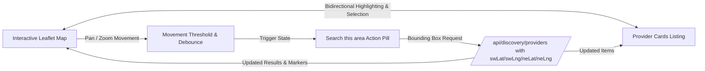

# Interactive Map Architecture & Spatial Synchronization

## 1. Overview
Bookline's marketplace map provides real-time, bidirectional spatial synchronization between interactive cartography and discovery listings. It is a functioning spatial navigation tool, not a static illustrative map image.

---

## 2. Selected Provider & Cartography Stack
- **Library**: `Leaflet` (v1.9.4) via `@types/leaflet` with lightweight React lifecycle integration (`frontend/src/components/maps/DiscoveryMap.tsx`).
- **Cartography Tiles**: CartoDB Dark Matter tiles matching Bookline's dark design system palette (`#0B0E14` / `#111620`):
  - URL Template: `https://{s}.basemaps.cartocdn.com/dark_all/{z}/{x}/{y}{r}.png`
  - Attribution: `&copy; <a href="https://www.openstreetmap.org/copyright">OpenStreetMap</a> &copy; <a href="https://carto.com/attributions">CARTO</a>`
  - Max Zoom: 19

### Environment Variables
| Variable | Description | Default |
|---|---|---|
| `VITE_MAP_PROVIDER` | Map engine identifier (`leaflet`, `mapbox`, `google`) | `leaflet` |
| `VITE_MAP_TILE_URL` | Custom tile server URL template | CartoDB Dark Matter |
| `VITE_MAPBOX_ACCESS_TOKEN`| Mapbox public token if Mapbox provider selected | `""` |

---

## 3. Bidirectional Map/List Synchronization
1. **List-to-Map Hover & Selection**:
   - Hovering over a `ProviderCard` pulses and scales the corresponding marker pin on the map.
   - Clicking a card pans the map smoothly to the provider's exact coordinates.
2. **Map-to-List Marker Click**:
   - Clicking a map marker opens a floating provider preview popover displaying:
     - Business name and verified status badge
     - Category and micro-area address
     - Rating and review count
     - Starting price
     - Direct "Book" or "View storefront" link
   - Automatically scrolls the corresponding list card into view with active ring styling (`#E8546A`).

---

## 4. "Search This Area" State Machine & Anti-Loop Protection
To prevent infinite request loops during user interaction:
- **Threshold Gating**: The map tracks `initialBounds`. A move event triggers the `"Search this area"` pill only if the center has shifted by $> 300\text{ meters}$ or the zoom delta is $\ge 1$.
- **Explicit Customer Intent**: Panning does not automatically fire API queries. The customer must explicitly click `"Search this area"` to query the new viewport.
- **Debounced Viewport Calculations**: Viewport queries are debounced to ensure network efficiency.

---

## 5. Mobile & Desktop Responsive Behaviors
- **Desktop ($\ge 1024\text{px}$)**: Split-screen side-by-side layout: left scrollable provider list, right sticky spatial map viewport.
- **Mobile ($< 768\text{px}$)**: Segmented switch pill allows toggling between full-screen List view and full-screen Map view with bottom floating preview cards.

---

## 6. Truthful Map State & Failure Handling
- **Missing Configuration**: If an external map provider is unconfigured, the application displays a truthful banner: *"Map configuration required. Displaying list view."*
- **Offline / Tile Degradation**: If tiles fail to load, the provider list remains 100% usable, interactive, and bookable.
