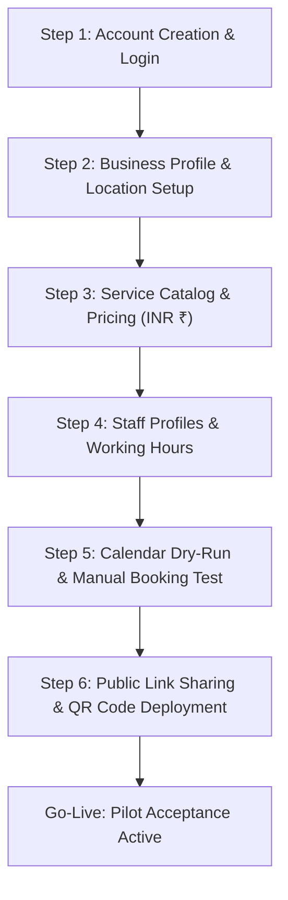

# Bookline — Gujarat Pilot Onboarding & Operations Guide

This guide details the onboarding workflow, initial configuration, and operational best practices for the five Gujarat pilot businesses participating in the Bookline initial rollout.

---

## 1. Pilot Cohort Overview

The pilot cohort represents five distinct appointment-driven service industries across key commercial hubs in Gujarat:

| # | Business Name | Category | City / Location | Time Zone | Pilot Contact | Direct Booking Link |
|---|---|---|---|---|---|---|
| 1 | **Aura Wellness Spa** | Wellness & Massage | Bodakdev, Ahmedabad | `Asia/Kolkata` (IST) | `+91 98250 11223` | `/business/aura-wellness` |
| 2 | **Glow Hair & Beauty Studio** | Salon & Esthetics | Vesu, Surat | `Asia/Kolkata` (IST) | `+91 98980 22334` | `/business/glow-studio` |
| 3 | **Apex Dental Clinic** | Healthcare & Dentistry | Kalawad Road, Rajkot | `Asia/Kolkata` (IST) | `+91 97270 33445` | `/business/apex-dental` |
| 4 | **Lumina Portrait Studio** | Photography & Creative | Alkapuri, Vadodara | `Asia/Kolkata` (IST) | `+91 94260 44556` | `/business/lumina-studio` |
| 5 | **Vanguard Advisory** | Legal & Tax Advisory | Infocity, Gandhinagar | `Asia/Kolkata` (IST) | `+91 99090 55667` | `/business/vanguard-advisory` |

---

## 2. Onboarding Workflow (Step-by-Step)

---

### Step 1: Provider Registration & Workspace Setup
1. The business owner opens `https://app.bookline.in/register` (or `http://localhost:5168/register` in staging).
2. Enter owner name, business email, Indian mobile number (`+91 98...`), and strong password.
3. Upon registration, the business tenant workspace is initialized in PostgreSQL with tenant isolation enabled.

### Step 2: Business Profile & Operating Hours
1. Navigate to **Settings -> Business Profile**.
2. Configure:
   - **Business Name** & unique URL slug (e.g. `aura-wellness`).
   - **Category**: Select appropriate service vertical.
   - **Address**: Complete physical address including pin code.
   - **Operating Hours**: Configure Monday through Saturday (e.g., 10:00 AM to 08:00 PM IST) with lunch breaks. Sunday marked as Closed or customized hours.
   - **Time Zone**: Confirm set to `Asia/Kolkata` (+05:30).

### Step 3: Service Catalog Configuration
1. Navigate to **Services -> Add New Service**.
2. For each service, define:
   - **Service Name** (e.g., "Deep Tissue Massage 60m", "Bridal Hair Styling", "Root Canal Consultation").
   - **Duration**: Duration in minutes (e.g., 30, 45, 60, 90).
   - **Buffer Times**:
     - *Pre-service buffer*: Cleaning / setup time (e.g., 10 mins).
     - *Post-service buffer*: Sanitization / turnaround time (e.g., 15 mins).
   - **Price**: Retail price in Indian Rupees (₹).
   - **Assigned Staff**: Select staff qualified to perform the service.

### Step 4: Staff Onboarding & Scheduling
1. Navigate to **Staff -> Add Staff Member**.
2. Input staff name, contact phone, role, and bio.
3. Configure **Individual Working Hours**:
   - If staff member works custom shifts (e.g. 11:00 AM - 07:00 PM), override the business default.
   - Add recurring breaks (e.g., 01:30 PM - 02:30 PM).
4. Save schedule. The availability engine immediately takes staff working hours, breaks, and buffers into account.

### Step 5: Calendar Dry-Run & Manual Booking Test
1. Navigate to **Calendar**.
2. Verify **Day** and **Week** views render correctly with staff column filtering.
3. Click **New Appointment** button:
   - Select Source: `Phone`, `Walk-In`, `WhatsApp`, or `Instagram`.
   - Select Customer (or enter new customer details).
   - Select Service and assigned Staff.
   - Choose time slot.
   - Add private provider notes (internal instructions not visible to customer).
   - Save appointment.
4. Verify the appointment tile renders on the calendar with `Confirmed` badge.
5. Click appointment to test lifecycle transitions: `CheckedIn` -> `Completed`.

### Step 6: Public Link Sharing & Customer Booking Test
1. Share the direct storefront URL (`/business/{slug}`) via WhatsApp or Instagram bio.
2. In an incognito tab (simulating a customer):
   - Choose a service.
   - Select preferred staff (or "Any Available").
   - Pick an open date and time slot.
   - Fill in customer name, phone, and email.
   - Confirm booking.
3. Confirm that:
   - A 5-minute hold was created and converted into a confirmed booking.
   - Customer received booking confirmation with access token link.
   - Provider calendar updated immediately with `Online` source appointment.
   - Outbox worker queued the transactional confirmation notification.

---

## 3. Daily Operational Best Practices for Pilot Businesses

- **Walk-Ins & Phone Calls**: Always log walk-ins and phone bookings immediately using the **New Appointment** dialog. This ensures the slot is instantly locked from online customers.
- **Managing No-Shows**: Mark appointments as `NoShow` if the customer does not arrive within 20 minutes. This frees up staff records for accurate analytics.
- **Provider Notes Confidentiality**: Use the notes field for internal client history (e.g., allergies, color formulas, dental charts). These notes are strictly isolated and never shown on public storefronts or customer links.
- **Rescheduling**: Use the Reschedule modal on the appointment drawer to select a new slot; Bookline will automatically re-verify staff availability before moving the booking.

---

## 4. Pilot Support & Escalation Contacts

- **Pilot Operations Hotline**: `+91 99000 88776` (Available 09:00 - 21:00 IST)
- **Emergency Incident Email**: `pilot-support@bookline.in`
- **Technical Lead WhatsApp Group**: Bookline Gujarat Pilot Ops
