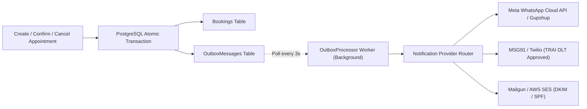

# Bookline — Production Notification Strategy (India / Gujarat Pilot)

> [!IMPORTANT]
> **Zero Delivery Hallucination Principle**:
> Bookline strictly maintains that WhatsApp or SMS notifications are never reported as "delivered" unless acknowledged by a configured, authorized carrier gateway. In development and local staging without carrier credentials, the system executes through the `LocalNotificationAdapter` or `ConsoleNotificationAdapter` and explicitly records carrier status as `SIMULATED_LOCAL`.

---

## 1. Notification Architecture

Bookline utilizes a decoupled **Transactional Outbox Architecture** to ensure that appointment state persistence and notification dispatch are strictly isolated and failure-resilient:



### Key Architectural Guarantees:
1. **Atomic Enqueueing**: The appointment mutation and the corresponding notification outbox event are persisted inside the **same database transaction**.
2. **Failure Isolation**: If an external carrier (WhatsApp, SMS, or SMTP) experiences an outage, timeout, or rate limit, **the customer's confirmed booking is NEVER rolled back**.
3. **At-Least-Once Delivery**: The `OutboxProcessor` worker retrieves unprocessed records with row-level locks (`FOR UPDATE SKIP LOCKED`), dispatches via the active carrier adapter, and marks records `ProcessedAtUtc`.
4. **Exponential Backoff with Jitter**: Transient carrier failures trigger retry schedules ($2^n \times 30\text{s} \pm \text{jitter}$), capping at 5 attempts before quarantine in `FailedOutboxMessages`.
5. **Idempotent Hand-off**: All carrier dispatches submit deterministic `Idempotency-Key` headers derived from `OutboxMessage.Id` to prevent duplicate messaging to customers.

---

## 2. Carrier Specifications & India Regulatory Compliance

### 2.1 WhatsApp Business Messaging (Primary Pilot Channel)
- **Carrier Transport**: Meta WhatsApp Cloud API (direct Graph API v19.0+) or Gupshup Enterprise WhatsApp Gateway.
- **Session Types**:
  - **Business-Initiated (Utility)**: Appointment confirmation, 24h reminders, cancellations, and reschedules. **Mandatory**: Must use pre-approved Meta WhatsApp Message Templates. Free-form text is rejected by Meta.
  - **User-Initiated (Service)**: 24-hour customer service window where interactive text responses are permissible.
- **Template Payload Example**:
  ```json
  {
    "messaging_product": "whatsapp",
    "to": "919825000000",
    "type": "template",
    "template": {
      "name": "bookline_appointment_confirmed",
      "language": { "code": "en" },
      "components": [
        {
          "type": "body",
          "parameters": [
            { "type": "text", "text": "Priya Sharma" },
            { "type": "text", "text": "Aura Wellness & Spa" },
            { "type": "text", "text": "Deep Tissue Therapy" },
            { "type": "text", "text": "Saturday, 15 Nov at 10:30 AM" }
          ]
        }
      ]
    }
  }
  ```

### 2.2 SMS Messaging & Telecom Regulatory Authority of India (TRAI) DLT Compliance
India's Telecom Commercial Communications Customer Preference Regulations (TCCCPR 2018) require distributed ledger technology (DLT) compliance for all A2P (Application-to-Person) SMS.

- **Mandatory Requirements**:
  1. **Principal Entity (PE) Registration**: Bookline Technologies must be registered on a telecom DLT portal (Jio, Airtel, Vodafone Idea, or BSNL).
  2. **Sender ID (Header) Whitelisting**: Exactly 6 alphanumeric characters representing the brand, registered under Service Implicit category (e.g., `BOKLIN` or `BKLNSE`).
  3. **Content Template Registration**: Every message variant must be registered with exact placeholder variables (e.g., `{#var#}`). Any discrepancy causes immediate telecom gateway rejection.
  4. **Consent Recording**: Implicit transactional consent generated at customer booking checkout.
- **DLT Template Definition**:
  - *Template Name*: `BOOKLINE_BOOKING_CONFIRMATION`
  - *Template ID*: `1407169823450011223`
  - *Template Text*:
    ```text
    Dear {#var#}, your appointment for {#var#} at {#var#} is confirmed for {#var#}. Manage your booking: {#var#} - Bookline
    ```
- **Carrier Gateways**: MSG91 or Twilio India Gateway with DLT Header and Template ID passthrough headers.

### 2.3 Transactional Email (SMTP / HTTP API)
- **Carrier Transport**: Mailgun HTTP API or AWS SES (eu-west-1 / ap-south-1 Mumbai).
- **Authentication Standards**:
  - **SPF**: `v=spf1 include:mailgun.org ~all`
  - **DKIM**: 2048-bit domain key (`k=rsa; p=MIIBIjAN...`)
  - **DMARC**: `v=DMARC1; p=reject; rua=mailto:dmarc-reports@bookline.in`
- **Rate & Bounce Protection**: Dedicated sending IP or high-reputation shared IP pool with automatic webhook handling for bounces and spam complaints.

---

## 3. Environment Strategy: Local vs Staging vs Production

| Component | Development | Staging | Production |
| :--- | :--- | :--- | :--- |
| **Provider Adapter** | `LocalConsoleAdapter` / `Mailpit` | `SimulatedCarrierAdapter` or Staging Test Creds | `ProductionCarrierAdapter` (Meta / MSG91 / SES) |
| **WhatsApp Dispatch** | Logged to console | Meta Test Phone Numbers | Real Customer Numbers |
| **SMS Dispatch** | Logged to console | MSG91 Test Sandbox / Mock | Real Indian Mobile (`+91`) |
| **Email Dispatch** | Port 1026 Mailpit UI (`localhost:8026`) | Verified domain staging inbox | Customer recipient inbox |
| **Carrier Credentials** | None required | Staging API Keys | Production Vault / KMS Secrets |

---

## 4. Operational Monitoring & Failure Handling

1. **Dead Letter Queue / Quarantine**: Messages failing 5 consecutive retries are marked `Status = DeadLetter` in `OutboxMessages` with the full carrier error code.
2. **Admin Alerting**: Worker logs emit `NotificationDeliveryFailed` structured events with tenant ID, channel, and error reason.
3. **Manual Replay API**: Platform Administrators can trigger `/api/v1/admin/outbox/{id}/retry` after resolving carrier quota or credential issues.

