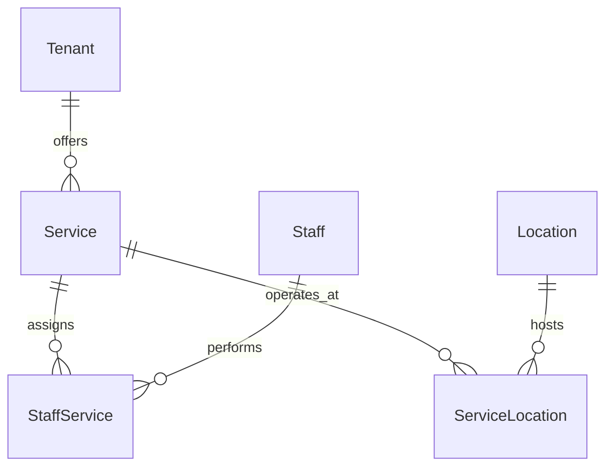

# Service Catalogue & Treatment Architecture

## 1. Overview
In Bookline, a **Service** represents a bookable treatment or consultation that consumes time, specialist availability, and physical facilities. This distinguishes it fundamentally from a **Product**, which consumes physical retail inventory.

---

## 2. Entity Schema & Attributes
The `Service` entity (`Bookline.Domain.Entities.Service`) encapsulates full operational semantics:

| Field | Type | Description |
|---|---|---|
| `Id` | `Guid` | Primary identifier |
| `TenantId` | `Guid` | Tenant ownership boundary (strict cross-tenant isolation) |
| `Name` | `string` | Display title (e.g., "Deep Cleansing Hydrafacial") |
| `Slug` | `string` | URL-safe identifier (e.g., "deep-cleansing-hydrafacial") |
| `Description` | `string` | Detailed narrative of the treatment protocol |
| `CategoryId` | `Guid?` | Commercial service classification |
| `DurationMinutes` | `int` | Appointment duration (strictly $> 0$, typically 15 to 480 mins) |
| `BufferBeforeMinutes` | `int` | Specialist preparation / room setup time ($\ge 0$) |
| `BufferAfterMinutes` | `int` | Sanitation, turnover, or client cooldown time ($\ge 0$) |
| `Price` | `decimal` | Treatment price (strictly $\ge 0$) |
| `Currency` | `string` | Currency code (defaults to `INR` / `USD`) |
| `IsBookableOnline` | `bool` | Whether clients can reserve self-service via marketplace |
| `IsPublished` | `bool` | Public visibility flag (unpublished = draft) |
| `Status` | `string` | Lifecycle state: `Active`, `Draft`, `Archived` |
| `IsActive` | `bool` | Soft-delete active flag |
| `IsArchived` | `bool` | Soft-delete archive flag |

---

## 3. Staff Assignment (Many-to-Many)
A service can be performed by multiple specialists; a specialist can offer multiple services.
- Managed via `StaffService` junction table (`ServiceId`, `StaffId`, `TenantId`).
- Cross-tenant validation: attempting to assign a staff member belonging to a foreign tenant is strictly rejected with a security validation exception.

---

## 4. Location-Specific Availability & Pricing (`ServiceLocation`)
Services are not silently available at every branch. Bookline explicitly models branch-specific service availability:
- Managed via `ServiceLocation` junction entity (`ServiceId`, `LocationId`, `TenantId`).
- Supports location-specific overrides:
  - Custom `PriceOverride` (e.g. flagship branch vs suburban branch pricing).
  - Custom `DurationMinutesOverride`.
  - `IsAvailableAtLocation` active toggle.

---

## 5. Strict Validation & Bookability Guards
A service is bookable online if and only if:
$$\text{Bookable} \iff \text{IsActive} \land \neg\text{IsArchived} \land \text{IsPublished} \land \text{IsOnlineBookingEnabled}$$

### Business Error Codes
| Code | Condition |
|---|---|
| `SERVICE_NOT_FOUND` | Service ID does not exist or belongs to another tenant |
| `SERVICE_NOT_BOOKABLE` | Service is unpublished, archived, or disabled for online booking |
| `SERVICE_STAFF_INVALID` | Assigned specialist does not belong to the service tenant |
| `SERVICE_LOCATION_INVALID` | Assigned location does not belong to the service tenant |
| `SERVICE_SLUG_COLLISION` | Auto-disambiguated with numeric counter suffix |
