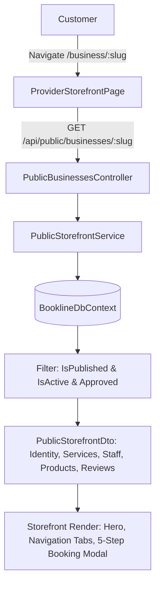

# Provider Storefront Architecture

## 1. Overview
The Provider Storefront is the public digital presence for verified service providers on Bookline (`/business/:slug`). It provides clients with authoritative business identity, location options, service catalogues, staff credentials, verified reviews, and real-time appointment booking.

---

## 2. Public vs. Private Data Separation
Bookline enforces strict privacy and tenant isolation boundaries:

### Public Storefront Surface (Unrestricted)
- Business Name, Slug, Category, Description
- Public Address, City, Postal Code, Phone, Website
- Published Services: Name, Description, Duration, Price, Currency
- Verified Specialists: First Name, Last Name, Professional Title, Bio, Avatar
- Public Retail Products: Name, Description, Price, Stock Availability
- Operational Hours by Day of Week
- Verified Customer Reviews & Average Rating

### Private Provider Surface (Strictly Denied)
- Customer PII (Full booking lists, customer notes, email databases)
- Financial Data (Gross revenue, net payouts, platform commission splits, bank accounts)
- Internal Scheduling (Staff break notes, time-off requests, internal shifts)
- Unpublished / Draft Treatments (`IsPublished = false`)

---

## 3. Storefront Navigation Tabs
The storefront organizes rich content into clean, accessible tabs:
1. **Services** (Default): Category-grouped treatments with duration pills, price tags, and direct "Book" buttons.
2. **About / Locations**: Full narrative bio, amenities (Wi-Fi, parking, card payments), and multi-branch address directory.
3. **Specialist Team**: Provider master practitioners with individual bios and specialties.
4. **Reviews**: Customer testimonials with star ratings, timestamp, and verified booking badges.
5. **Retail Essentials**: Shop products offered by the provider for home care or pickup.
6. **Operating Hours**: Real weekly hours schedule.

---

## 4. Multi-Location Selection
For multi-branch providers (e.g. Aura Wellness Bodakdev vs. Vastrapur):
- Step 1 of the booking flow provides an interactive location selector.
- Services applicable only to specific branches are filtered accordingly.
- The confirmation card and calendar ICS export reflect the exact selected location address.

---

## 5. End-to-End Booking Handoff
When a customer clicks "Book" from any service card:
1. **Context Preserved**: Service ID, Location ID, and optional Specialist ID are loaded into the 5-step booking modal.
2. **Step 1**: Treatment verification & branch selection.
3. **Step 2**: Specialist choice (or "Any Available Specialist").
4. **Step 3**: Authoritative live slot retrieval from the calendar engine via `/api/v1/public/availability`.
5. **Step 4**: 5-minute guaranteed hold acquisition via `/api/v1/public/hold` with live countdown timer.
6. **Step 5**: Instant confirmation via `/api/v1/public/book`, generating a unique booking reference (`BL-XXXXXX`) and one-click `.ics` calendar download.

---

## 6. Unavailable & Unpublished States
- If a provider is unpublished or pending moderation, `/api/public/businesses/:slug` returns HTTP 404 (`BUSINESS_NOT_FOUND`).
- The frontend renders an informative "Provider Not Available" state with an option to explore other verified providers in the marketplace.
