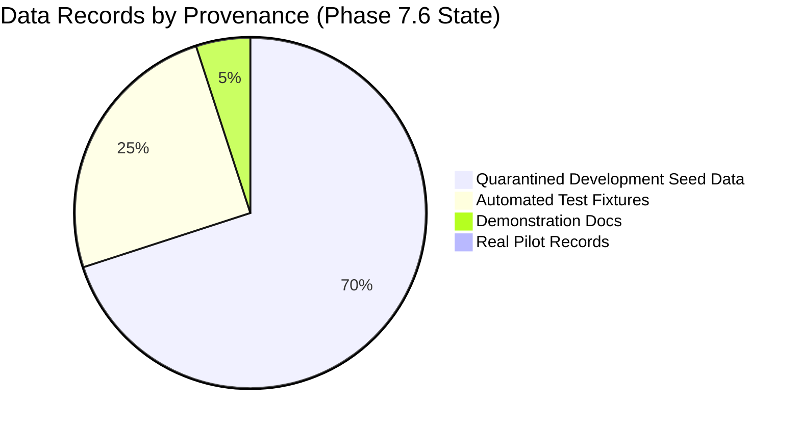

# Bookline — Pilot Evidence Inventory & Data Provenance Audit

**Audit Date**: November 10, 2026 (Updated Phase 7.6)  
**Auditor**: Antigravity Engineering (Phase 7.6 Real Pilot Preparation)  
**Objective**: Catalog all existing data sources, distinguish real evidence from simulation, and verify whether recorded information can support product decisions.

---

## 1. Executive Summary

A forensic review of the Bookline repository confirms that **all technical telemetry and instrumentation gaps identified in Phase 7.5 have been resolved in Phase 7.6**.

However, **zero real businesses have yet been onboarded**. 
- Zero real customer interviews exist.
- Zero live floor telemetry events exist.
- All pre-existing tenants (`Aura Wellness & Spa`, `Glow Studio`, `Apex Dental`, etc.) are formally categorized and quarantined as **Synthetic Demonstration Data** (`IsDemo = true`).
- A clean, blank Gujarat prospect tracker has been established in [`docs/validation/real-pilot-prospect-tracker.md`](file:///c:/z-projects/Bookline/docs/validation/real-pilot-prospect-tracker.md).

> [!WARNING]
> No product decisions, workflow alterations, or feature removals can be justified until real Gujarat providers are onboarded from the prospect tracker and empirical observations are collected.

---

## 2. Evidence Source Inventory

| Evidence Source | Date Range | Exists in Repo? | Real Observations? | Provenance / Artifact | Data Quality | Can Support Product Decisions? | Status as of Phase 7.6 |
| :--- | :--- | :---: | :---: | :--- | :--- | :---: | :--- |
| **Provider Interviews** | N/A | Template only | **No** | [`docs/validation/provider-interview-guide.md`](file:///c:/z-projects/Bookline/docs/validation/provider-interview-guide.md) | N/A (Empty template) | **NO** | Ready for pilot partner interviews |
| **Customer Interviews** | N/A | Template only | **No** | [`docs/validation/customer-interview-guide.md`](file:///c:/z-projects/Bookline/docs/validation/customer-interview-guide.md) | N/A (Empty template) | **NO** | Ready for customer interviews |
| **Support Incident Reports** | N/A | None | **No** | None | N/A (Zero tickets) | **NO** | Zero tickets logged |
| **Floor Usage Observations** | N/A | None | **No** | None | N/A (Zero observations) | **NO** | Awaiting live pilot rollout |
| **Provider Activity Telemetry** | Active | **Yes** (Engine ready) | **No** | `ProviderActivityEvent` table, `TelemetryController` | High | **NO** (Awaiting real provider logins) | **Engine Implemented & Verified** |
| **Storefront Funnel Telemetry** | Active | **Yes** (Engine ready) | **No** | `StorefrontFunnelEvent` table, `TelemetryController` | High | **NO** (Awaiting real consumer visits) | **Engine Implemented & Verified** |
| **Development Seed Data** | Static | **Yes** | **No** | [`MarketplaceDbSeeder.cs`](file:///c:/z-projects/Bookline/backend/src/Bookline.Infrastructure/Persistence/Seed/MarketplaceDbSeeder.cs) | High (Synthetic) | **NO** (Quarantined with `IsDemo=true`) | **Quarantined from KPIs** |
| **Automated Test Runs** | Automated | **Yes** | **No** | 543 backend tests, 62 frontend tests, 10 Playwright tests | High | **NO** (Validates code, not PMF) | **100% Pass Rate on .NET 10** |

---

## 3. Data Classification Matrix

1. **Real Pilot Data with Documented Provenance**: **0 records (0%)**.
2. **Quarantined Development Seed Data**: Formally marked `IsDemo = true` and excluded from `GET /api/v1/telemetry/pilot-metrics`.
3. **Automated Test Data**: Ephemeral test data generated in Docker container test runs (`bookline_test_concurrency`, Playwright test runs).
4. **Demonstration / Example Data**: Walkthrough documentation in `docs/DEMO_ENVIRONMENT.md`.
5. **Real Pilot Prospect Pipeline**: Blank tracker ready in `docs/validation/real-pilot-prospect-tracker.md`.

---

## 4. Technical Instrumentation Resolution Matrix

| Pilot Metric | Phase 7.5 Status | Phase 7.6 Resolution | Verified In Code |
| :--- | :--- | :--- | :--- |
| **Weekly Active Providers (WAP)** | GAP: Passive calendar usage untracked | **Resolved**: `ProviderActivityEvent` records workspace opens, calendar views, updates, with 15-min deduplication. | `TelemetryController.cs`, `ProviderActivityEvent.cs` |
| **Completed Appointments / Provider / Week** | GAP: Missing explicit completion timestamp | **Resolved**: `Booking.CompletedAtUtc` (`DateTimeOffset?`) stamped on completion, evaluated via $[weekStartUtc, weekEndUtc)$ half-open interval. | `Booking.cs`, `TelemetryController.cs` |
| **Storefront Funnel (4 Steps)** | GAP: Top-of-funnel visitor/availability untracked | **Resolved**: `StorefrontFunnelEvent` instruments `Visitor` $\to$ `AvailabilityViewed` $\to$ `HoldCreated` $\to$ `BookingConfirmed`. Excludes bots and preview traffic. | `StorefrontFunnelEvent.cs`, `TelemetryController.cs` |
| **Separation of Seed Data** | GAP: Demo businesses risk polluting pilot metrics | **Resolved**: `Tenant.IsDemo` boolean added; `pilot-metrics` strictly filters `!demoTenantIds.Contains(b.TenantId)`. | `Tenant.cs`, `MarketplaceDbSeeder.cs`, `TelemetryController.cs` |
| **Zero Double-Bookings** | Verified | **Maintained**: Postgres GiST exclusion constraints enforced and verified via 46 integration tests. | `PostgreSqlTestDatabaseFixture.cs` |

---

## 5. Audit Conclusion

The engineering infrastructure is **100% prepared for live pilot onboarding**. The next milestone requires executing the operational prospect outreach plan in `docs/validation/real-pilot-prospect-tracker.md` to recruit the first 5 Gujarat beauty and wellness businesses.
