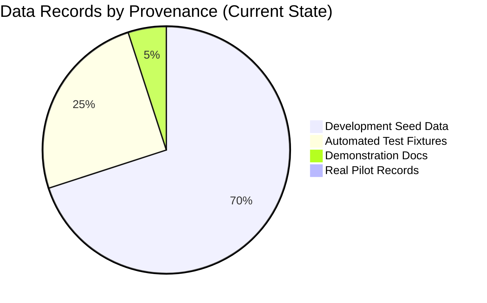

# Bookline — Pilot Evidence Inventory & Data Provenance Audit

**Audit Date**: November 10, 2026  
**Auditor**: Antigravity Engineering (Phase 7.5 Audit)  
**Objective**: Catalog all existing data sources, distinguish real evidence from simulation, and verify whether recorded information can support product decisions.

---

## 1. Executive Summary

A forensic review of the Bookline repository, database definitions, and documentation reveals **zero real pilot observations, zero genuine customer interviews, zero real support tickets, and zero floor telemetry records**. 

All apparent provider names (e.g., *Aura Wellness*, *Glow Studio*, *Apex Dental*) and customer transactions (e.g., *BL-GLW-101*, *BL-749218*) originate exclusively from **Development Seed Data** ([`MarketplaceDbSeeder.cs`](file:///c:/z-projects/Bookline/backend/src/Bookline.Infrastructure/Persistence/Seed/MarketplaceDbSeeder.cs)) and **Automated Integration/E2E Tests** ([`pilotJourneys.spec.ts`](file:///c:/z-projects/Bookline/frontend/e2e/pilotJourneys.spec.ts)).

> [!WARNING]
> No product decisions, workflow alterations, or feature removals can be justified until real businesses are onboarded and empirical observations are collected.

---

## 2. Evidence Source Inventory

| Evidence Source | Date Range | Exists in Repo? | Real Observations? | Provenance / Artifact | Data Quality | Can Support Product Decisions? | Missing Information Required |
|---|---|---|---|---|---|---|---|
| **Provider Interviews** | N/A | **No** (Template only) | **No** | [`docs/validation/provider-interview-guide.md`](file:///c:/z-projects/Bookline/docs/validation/provider-interview-guide.md) | N/A (Empty template) | **NO** | Verbatim interview responses from owners and receptionists across the 5 pilot salons/clinics. |
| **Customer Interviews** | N/A | **No** (Template only) | **No** | [`docs/validation/customer-interview-guide.md`](file:///c:/z-projects/Bookline/docs/validation/customer-interview-guide.md) | N/A (Empty template) | **NO** | Real customer feedback on direct link booking, reminder clarity, and cancellation UX. |
| **Support Incident Reports** | N/A | **No** | **No** | None | N/A (Zero tickets) | **NO** | Incident logs, WhatsApp operational escalations, reported bugs, or receptionist friction points. |
| **Floor Usage Observations** | N/A | **No** | **No** | None | N/A (Zero observations) | **NO** | Time-and-motion observations: time to log walk-in, device used (phone vs tablet), language preference. |
| **Platform Telemetry / Logs** | Staging / Local | **Yes** (Automated runs only) | **No** | Serilog logs, Docker traces, `BooklineMetrics` | High (Technical validity only) | **NO** (Only validates code correctness, not market fit) | Real traffic logs, genuine provider activity timestamps, real conversion funnels. |
| **Development Seed Data** | Static | **Yes** | **No** | [`MarketplaceDbSeeder.cs`](file:///c:/z-projects/Bookline/backend/src/Bookline.Infrastructure/Persistence/Seed/MarketplaceDbSeeder.cs) | High (Deterministic synthetic data) | **NO** (Synthetic artifacts strictly blocked in Prod) | Real customer identities, authentic price points, actual duration variances. |
| **Automated Test Runs** | Automated | **Yes** | **No** | [`Phase7SecurityAndPilotReadinessTests.cs`](file:///c:/z-projects/Bookline/backend/tests/Bookline.IntegrationTests/Phase7SecurityAndPilotReadinessTests.cs), Playwright E2E | High (Deterministic assertions) | **NO** (Proves software reliability, not business usability) | Human user interaction edge cases. |

---

## 3. Data Classification Matrix

1. **Real Pilot Data with Documented Provenance**: **0 records (0%)**.
2. **Development Seed Data**: **100% of existing database records** in local/dev environments (`admin@bookline.local`, `provider@bookline.local`, `Aura Wellness & Spa`, `BL-GLW-101`).
3. **Automated Test Data**: Ephemeral test data generated in Docker container test runs (e.g., `bookline_test_concurrency`, Playwright test runs).
4. **Demonstration / Example Data**: Walkthrough documentation in `docs/DEMO_ENVIRONMENT.md` and mock monthly breakdowns in `AdminController.GetPlatformReports`.
5. **Unknown Provenance**: None. Every record has traceable code or script origins.

---

## 4. Technical Instrumentation Audit

| Pilot Metric | Instrumentation Status | Storage / Event Source | Instrumentation Gap / Vulnerability |
|---|---|---|---|
| **Active Providers / Week** | **Partially Instrumented** | `Bookings` (`CreatedAtUtc`), `AuditLogs` | **GAP**: Providers who log in, view calendar, or review schedules without creating/updating a record leave NO trace. `LastLoginAtUtc` is missing on `AppUser`. |
| **Completed Appointments / Provider / Week** | **Accurately Instrumented** | `Bookings` (`Status = Completed`, `TenantId`, `EndUtc`) | None. Verified by transition queries. |
| **Total Appointments Created** | **Accurately Instrumented** | `Bookings` (`CreatedAtUtc`) | None. |
| **Appointment Sources** (Walk-in, Phone, WhatsApp, Instagram, Online) | **Accurately Instrumented** | `Bookings.Source` (`BookingSource` enum) | None. Controlled enum captured at creation. |
| **Online Booking Conversions** | **Partially Instrumented** | `BookingHolds` vs `Bookings` (`Source = Online`) | **GAP**: Hold-to-Booking conversion is measurable, but top-of-funnel Storefront page views are NOT instrumented. |
| **Cancellations & Reasons** | **Accurately Instrumented** | `Bookings` (`Status = Cancelled`, `CancellationReason`, `CancelledBy`) | None. Verified by audit log and entity fields. |
| **No-Show Tracking** | **Accurately Instrumented** | `Bookings` (`Status = NoShow`), `AuditLogs` | None. |
| **Rescheduling Frequency** | **Accurately Instrumented** | `AuditLogs` (`Action = BookingRescheduled`) | **GAP**: `Booking` entity lacks a `RescheduleCount` column; must query `AuditLogs`. |
| **Repeat Bookings** | **Accurately Instrumented** | `Bookings.CustomerId` grouping; `Customers.TotalBookingsCount` | None. Customer relation tracks repeat frequency. |
| **Notification Failures** | **Accurately Instrumented** | `OutboxMessages` (`Status = Failed/DeadLetter`), `BooklineMetrics` | None. Outbox worker logs errors and retries. |
| **Provider Retention** | **Partially Instrumented** | `Bookings.CreatedAtUtc` relative to `Tenant.CreatedAtUtc` | **GAP**: Measures only booking retention. Passive/calendar-only retention cannot be measured without session telemetry. |

---

## 5. Audit Conclusion

The software platform possesses **production-grade engineering reliability**, but currently operates in an **empirical vacuum**. No Phase 8 feature expansions, category additions, or architectural changes may be undertaken until real Gujarat pilot partners are actively running live appointments through Bookline.
