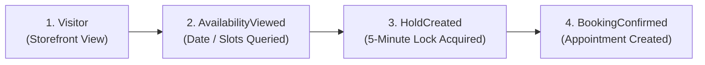

# Bookline — Pilot Performance Metrics & Validation Framework

> [!IMPORTANT]
> **Strict Operational Audit Standard (Phase 7.6)**:
> All automated pilot reporting must adhere to the **Half-Open Interval Standard** $[weekStartUtc, weekEndUtc)$ to prevent double-counting boundaries.
> Synthetic demonstration tenants (`IsDemo = true`) and automated test data are strictly excluded from all pilot calculations.

---

## 1. Pilot Evaluation Overview

The Bookline pilot program tests whether a provider-management SaaS platform tailored for salons, barbershops, beauty studios, and spas in Gujarat creates indispensable operational value.

The pilot evaluates two core hypotheses:
1. **Operational Utility Hypothesis**: Salon owners and staff actively use Bookline's unified calendar to log daily walk-ins, phone bookings, and manage schedules.
2. **Online Adoption Hypothesis**: Customers successfully use direct provider booking links (`/business/{slug}`) shared via WhatsApp and Instagram bio to book appointments, eliminating phone tag and scheduling conflicts.

---

## 2. Core Quantitative Pilot Metrics

| Metric Name | Formula / Query Definition | Target (Pilot) | Stretch Goal | Implementation Source |
| :--- | :--- | :---: | :---: | :--- |
| **Weekly Active Providers (WAP)** | Distinct `TenantId` with $\ge 1$ non-test `ProviderActivityEvent` in $[weekStartUtc, weekEndUtc)$ | $\ge 4$ of 5 providers | 5 of 5 providers | `GET /api/v1/telemetry/pilot-metrics` |
| **Completed Appointments per Active Provider / Wk** | $\frac{\text{Count of Bookings with Status=Completed and } CompletedAtUtc \in [startUtc, endUtc)}{\text{Weekly Active Providers}}$ | $\ge 15$ / provider / wk | $\ge 40$ / provider | `Bookings.CompletedAtUtc` half-open interval |
| **Appointment Capture Rate (Source Ratio)** | $\frac{\text{Direct Online Bookings}}{\text{Total Completed Bookings}} \times 100$ | $30\% - 50\%$ | $> 60\%$ | Grouped by `Booking.Source` |
| **Storefront Conversion Funnel (4 Steps)** | $\text{Visitor} \to \text{AvailabilityViewed} \to \text{HoldCreated} \to \text{BookingConfirmed}$ | $\ge 10\%$ visitor-to-booking | $\ge 20\%$ | `StorefrontFunnelEvent` table |
| **Zero Double-Booking Incidents** | Count of overlapping bookings for same staff in PostgreSQL | **0 incidents (100% integrity)** | **0 incidents** | Postgres GiST `no_overlap` constraint |
| **Provider Weekly Retention** | $\frac{\text{Providers active in Week } W \text{ and Week } W-1}{\text{Providers active in Week } W-1} \times 100$ | $\ge 80\%$ | $100\%$ | Weekly cohort activity matrix |

---

## 3. Timestamp Precision: `CompletedAtUtc` & Half-Open Intervals

### 3.1 Genuine Completion Timestamp (`CompletedAtUtc`)
Historically, appointment completion was tracked only by the status enum (`BookingStatus.Completed`) without a dedicated completion timestamp, causing ambiguity between scheduled appointment time and actual physical completion time.
- **Entity Property**: `Booking.CompletedAtUtc` (`DateTimeOffset?`)
- **Lifecycle**: Stamped atomically in UTC when the provider clicks "Mark Complete" or status transitions to `Completed`.
- **Integrity Rule**: Never backfilled with synthetic timestamps. Existing historical demo appointments retain `CompletedAtUtc = null`.

### 3.2 Half-Open Reporting Windows
To eliminate fencepost errors and duplicate counts across reporting cycles:
$$\text{Window} = [weekStartUtc, weekEndUtc) \iff t \ge weekStartUtc \land t < weekEndUtc$$

---

## 4. Provider Activity Telemetry (Section 122 & Phase 7.6)

Privacy-conscious provider workspace telemetry tracks authentic operational engagement without capturing sensitive business notes or customer PII.

### Permitted Provider Activity Events:
1. `ProviderWorkspaceOpened`: Provider logged in and viewed the business dashboard.
2. `ProviderCalendarViewed`: Provider opened or navigated the appointment calendar.
3. `ManualAppointmentCreated`: Provider staff scheduled a walk-in or phone client directly on the calendar.
4. `AppointmentUpdated`: Provider rescheduled, updated notes, or modified an appointment.
5. `AppointmentCompleted`: Provider marked an appointment physically completed.
6. `ServiceConfigurationUpdated`: Provider modified pricing, duration, or buffer times.
7. `StaffScheduleUpdated`: Provider adjusted staff shifts, breaks, or time-off.

### Deduplication & Integrity Safeguards:
- `ProviderWorkspaceOpened` and `ProviderCalendarViewed` are deduplicated within a **15-minute sliding window** per user.
- Actions performed by `PlatformAdmin` users are strictly excluded.
- Requests with `X-Automated-Test` or Playwright user agents are flagged `IsAutomatedOrTest = true` and filtered out of pilot KPIs.
- Synthetic demo tenants (`IsDemo = true`) are quarantined.

---

## 5. Storefront Conversion Funnel Instrumentation

The 4-step funnel measures the journey from public link discovery to confirmed booking:

### Funnel Step Definitions:
1. **Visitor**: Anonymous user opens `/business/{slug}`. Recorded once per pseudonymous `VisitorSessionId` per day (`DateKey = yyyy-MM-dd`).
2. **AvailabilityViewed**: Customer queries live slot availability for a specific service and date. Deduplicated per day per session.
3. **HoldCreated**: Customer selects a slot and the backend acquires a 5-minute atomic lock. Records `RelatedHoldId`.
4. **BookingConfirmed**: Customer submits verified contact info; appointment is persisted in PostgreSQL. Records `RelatedBookingId`.

### Bot and Preview Traffic Exclusion:
- Known crawler user agents (Googlebot, bingbot, curl, python, Postman, Playwright) are flagged `IsAutomatedOrBot = true`.
- Provider staff previewing their own storefront (via `X-Internal-Preview` header) are flagged `IsInternalPreview = true`.
- Only authentic, human-initiated consumer traffic is included in conversion calculations.

---

## 6. Pilot Telemetry API Endpoints

- `POST /api/v1/telemetry/provider-activity` — Records provider workspace interaction.
- `POST /api/v1/telemetry/storefront-funnel` — Records storefront funnel transition.
- `GET /api/v1/telemetry/pilot-metrics` — Generates aggregated pilot performance report using half-open intervals and demo quarantine.
